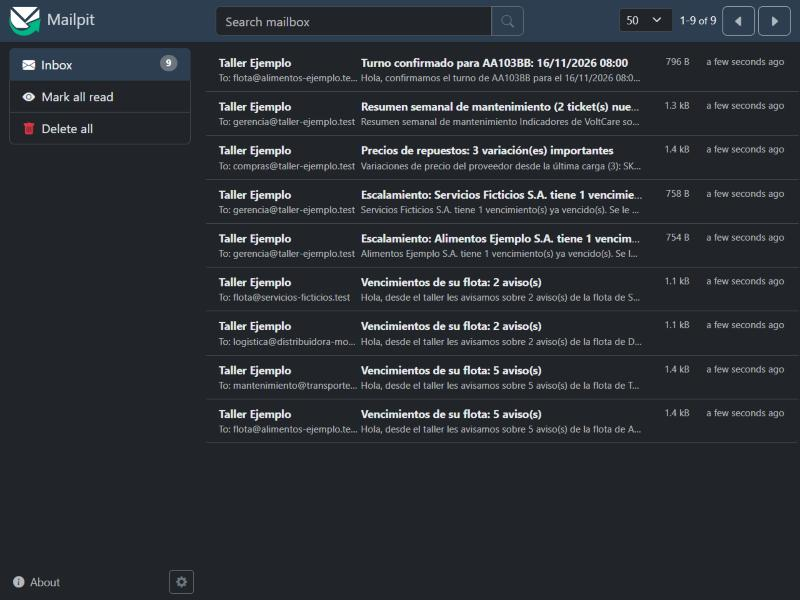
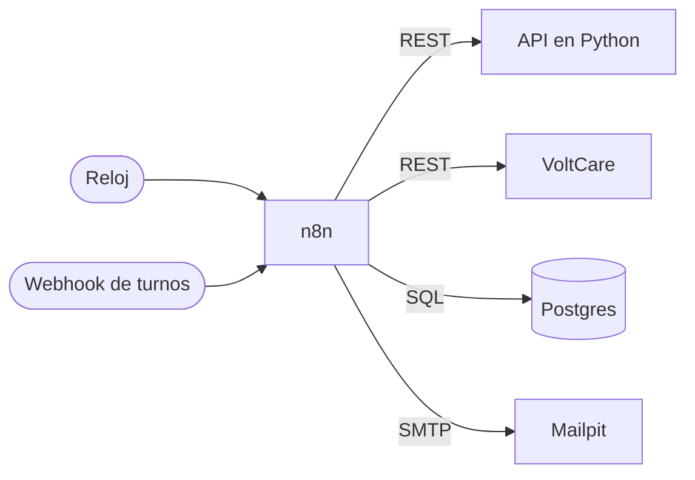

# flota-ops

Automatizaciones con [n8n](https://n8n.io) para la operación de un taller mecánico que atiende flotas de empresas: avisos de vencimientos, pedidos de turno, carga diaria de la lista de precios de repuestos y seguimiento del mantenimiento preventivo.

Todos los datos son ficticios (empresas, personas, patentes y correos).



## El problema

El taller atiende las flotas de varias empresas. Los vencimientos de VTV y seguro y los service por kilometraje se llevan en planillas, los turnos se piden por WhatsApp y la lista de precios del proveedor llega como un archivo que cada día viene distinto: cambian el separador, la codificación y el formato de los números, y a veces trae filas repetidas o inválidas.

Acá esas tareas corren solas: [flujos de n8n](docs/flujos.md) que leen y escriben en Postgres, hablan con dos APIs REST y avisan por email.

## Cómo está armado



- **n8n** orquesta: disparadores, ramas, esperas y avisos.
- **API en Python** (FastAPI) simula el sistema del taller y limpia con pandas el archivo del proveedor.
- **Postgres** guarda y calcula: upserts, vistas, historial de precios, staging del ETL.
- **VoltCare** ([otro repo mío](https://github.com/MaxDCoc/VoltCare-Analytics)) aporta los indicadores de mantenimiento (MTTR, preventivo contra correctivo).
- **Mailpit** atrapa los emails de prueba: nada sale a internet.

Más detalle en [docs/arquitectura.md](docs/arquitectura.md).

## Probarlo

Hace falta Docker y unos 3 GB de memoria libre. La primera vez tarda unos minutos porque construye las imágenes.

```bash
docker compose up -d --build
```

- n8n: <http://localhost:5678>. La primera vez pide crear un usuario local; sirve cualquier email.
- Emails (Mailpit): <http://localhost:8025>

Los flujos ya están importados y activos. Para verlos funcionar de una vez (en Windows, desde Git Bash):

```bash
sh scripts/demo.sh
```

Después mirá los emails en Mailpit y los datos con `psql` (el propio script indica cómo).

Para apagar todo: `docker compose down` (con `-v` también borra los datos).

## Los flujos

| Flujo | Cuándo corre | Qué hace |
|---|---|---|
| 00 - Sincronizar odómetros | Cada hora | Actualiza el kilometraje de cada vehículo desde la API del taller |
| 01 - Vencimientos de flota | Todos los días 08:00 | Un email por cliente con VTV, seguro y service por kilometraje; escala lo ya vencido |
| 02 - Pedido de turno | Webhook | Valida, consulta la agenda, reserva sin pisar horarios, confirma y recuerda 24 h antes |
| 03 - Lista de precios de repuestos | Todos los días 06:00 | Limpia el archivo del proveedor, guarda rechazos con su motivo, actualiza precios y avisa variaciones |
| 04 - Seguimiento preventivo | Lunes 08:00 | Indicadores de VoltCare, tickets a clientes sin servicio preventivo y resumen semanal |
| 99 - Errores | Cuando algo falla | Registra el error y avisa a operaciones |

Cada uno está explicado, con capturas, en [docs/flujos.md](docs/flujos.md).

## Decisiones de diseño

- **Reejecutar no duplica.** Los avisos llevan una clave por cliente y ventana de tiempo; los upserts y los `ON CONFLICT` evitan filas repetidas. Cada flujo se probó dos veces seguidas.
- **Sin bucles.** Los flujos solo arrancan por reloj o por una llamada externa. Ninguno escribe en algo que dispare a otro.
- **Un dato malo no frena el lote.** Las líneas inválidas del archivo del proveedor van a `stg.etl_rechazos` con su motivo, y el resto se carga. Cada línea de entrada termina limpia o rechazada: nunca se pierde en silencio.
- **Reintentos y errores.** Las llamadas HTTP reintentan con espera y todos los flujos apuntan al flujo `99 - Errores`.
- **Cada pieza hace lo suyo.** n8n no limpia datos ni calcula nada que pueda hacer la base: Python transforma, SQL fusiona y consulta.
- **Los umbrales no están en los flujos.** Días de aviso, variación de precio y días sin preventivo viven en la tabla `ops.config`.
- **Aviso una sola vez.** Antes de mandar, el flujo comprueba si ya existe el aviso; así un reinicio o una reejecución no llena la bandeja.

## Tests

```bash
make test        # o, sin make: docker run --rm -v "$PWD/api:/work" -w /work python:3.12-slim sh -c "pip install -q -r requirements.txt && ruff check . && pytest -q"
python scripts/check_workflows.py
```

La API tiene tests del ETL (coma decimal, codificaciones, duplicados, líneas inválidas, archivo vacío) y de los endpoints. `check_workflows.py` verifica que los JSON de n8n sean válidos, que las conexiones apunten a nodos que existen, que todos tengan flujo de errores y que no haya secretos adentro. Todo corre en [GitHub Actions](.github/workflows/ci.yml).

## Estructura

```
api/         FastAPI: simulación del taller y limpieza de precios (con tests)
sql/         esquema, datos de ejemplo y vistas
workflows/   un JSON por flujo de n8n (se importan solos al arrancar)
n8n/         arranque de n8n: importa credenciales y workflows
voltcare/    imagen de VoltCare, construida desde su repo
scripts/     demo y chequeo de workflows
docs/        arquitectura y flujos, con capturas
```

## Licencia

MIT. Ver [LICENSE](LICENSE).
