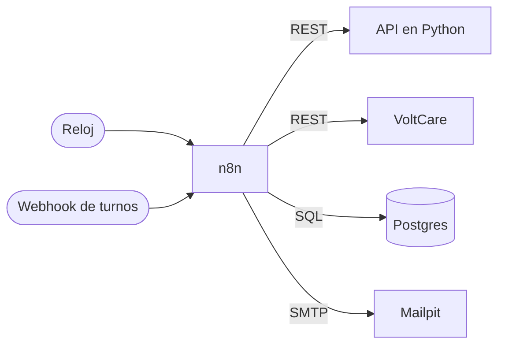

# Arquitectura

## Servicios

| Servicio | Imagen / origen | Rol |
|---|---|---|
| `n8n` | `n8nio/n8n:1.123.94` | Orquesta los flujos: disparadores, ramas, esperas, avisos |
| `postgres` | `postgres:16-alpine` | Datos operativos (`ops`), staging del ETL (`stg`) y la base interna de n8n |
| `api` | `./api` (FastAPI) | Simula el sistema del taller (odómetros, agenda) y limpia la lista de precios con pandas |
| `mailpit` | `axllent/mailpit` | Buzón SMTP de prueba: los emails se ven en `localhost:8025` y no salen a internet |
| `voltcare` | `./voltcare` (repo propio) | Indicadores de mantenimiento (MTTR, balance preventivo/correctivo) por API |

Cada pieza hace lo que mejor hace: **n8n orquesta**, **Python transforma**, **Postgres guarda y calcula**.

## Datos

Esquema `ops`:

- `clientes`, `vehiculos`, `mecanicos`, `vencimientos` (VTV y seguro), `servicios` (preventivos y correctivos) y `turnos`.
- `notificaciones`: cada aviso enviado deja una clave única, así que reejecutar un flujo no repite emails.
- `tickets_contacto`: un solo ticket abierto por cliente y motivo (índice único parcial).
- `precios_repuestos` y `precios_historial`: el historial solo suma una fila cuando el precio cambia.
- `config`: umbrales y destinatarios que leen los flujos (días de aviso, variación de precio, días sin preventivo, modo demo).
- Vistas: `v_avisos`, `v_clientes_sin_preventivo` y `v_variacion_precios`.

Esquema `stg`:

- `precios_raw`: cada línea del archivo del proveedor tal como llegó.
- `etl_rechazos`: las líneas que no pasaron la validación, con el motivo.

## Convenciones de los flujos

- **Idempotencia.** Los avisos usan una clave por cliente y ventana de tiempo; los upserts y los `ON CONFLICT` evitan duplicar filas.
- **Sin bucles.** Los flujos solo arrancan por reloj o por una llamada externa. Ninguno escribe en algo que dispare a otro.
- **Reintentos.** Las llamadas HTTP reintentan tres veces con espera.
- **Errores.** Todos los flujos tienen asignado el flujo `99 - Errores`: registra la falla en `ops.ejecuciones_error` y avisa a operaciones.
- **Datos inválidos.** Una línea mala no frena el lote: se aparta en `stg.etl_rechazos` con su motivo.
- **Configuración.** Los umbrales viven en `ops.config`, no en los flujos.
- **Disparador manual.** Cada flujo programado trae un disparador manual para poder ejecutarlo a demanda.
