# Flujos

Cada flujo programado trae además un disparador manual (**Ejecutar a mano**), así se puede correr a demanda. Desde la terminal:

```bash
docker compose exec -T n8n n8n execute --id=<id del flujo>
```

| Id | Flujo | Cuándo corre |
|---|---|---|
| `flota-00-odometros` | 00 - Sincronizar odómetros | Cada hora |
| `flota-01-vencimientos` | 01 - Vencimientos de flota | Todos los días a las 08:00 |
| `flota-02-turno` | 02 - Pedido de turno | Por webhook |
| `flota-03-precios` | 03 - Lista de precios de repuestos | Todos los días a las 06:00 |
| `flota-04-preventivo` | 04 - Seguimiento preventivo | Los lunes a las 08:00 |
| `flota-99-errores` | 99 - Errores | Cuando falla cualquier otro flujo |

## 00 - Sincronizar odómetros

Trae el kilometraje de cada vehículo desde la API del taller y actualiza `ops.vehiculos.km_actual`. Nunca baja un valor ya registrado (`GREATEST`), así que una lectura vieja o repetida no pisa el dato. Ese kilometraje alimenta los avisos de service del flujo 01.

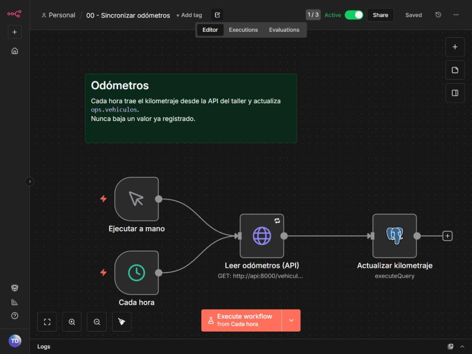

## 01 - Vencimientos de flota

Todas las mañanas arma **un email por cliente** con lo que vence en los próximos 30 días (VTV y seguro) y los vehículos que están por llegar al kilometraje de service.

- Los datos salen de la vista `ops.v_avisos`, que omite los vehículos que ya tienen un turno futuro.
- Cada aviso lleva una clave por cliente y ventana de 7 días (`aviso|<cliente>|<ventana>`). Si esa clave ya está en `ops.notificaciones`, el cliente no vuelve a recibir el aviso.
- Si el cliente tiene algo **ya vencido**, el flujo también escala a gerencia.
- Los umbrales (30 días, 7 días) viven en `ops.config`.

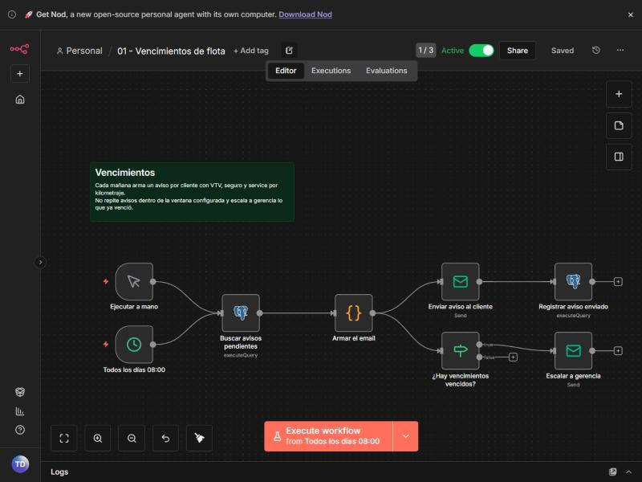

## 02 - Pedido de turno

Webhook que recibe el pedido de un turno, valida, consulta la agenda del taller por REST, reserva sin pisar horarios y confirma por email.

```bash
curl -X POST http://localhost:5678/webhook/turno \
  -H "Content-Type: application/json" \
  -d '{"patente":"AA103BB","fecha":"2026-11-16","hora":"08:00","motivo":"Revisión de frenos"}'
```

| Respuesta | Cuándo |
|---|---|
| `201` con `turno_id` y `cuando` | El turno se reservó y se mandó la confirmación |
| `400` con la lista de errores | Patente con formato inválido, fecha pasada o inválida, hora inválida, falta el motivo |
| `404` | No hay un vehículo activo con esa patente |
| `409` con `horarios_libres` | El horario no está disponible en la agenda |
| `409` | Ya existe un turno para ese vehículo en ese horario (restricción única en la base) |

El flujo responde al llamador apenas reserva y **sigue después**: espera hasta 24 horas antes del turno y manda el recordatorio solo si el turno sigue vigente (no cancelado). Para ver el recordatorio en segundos y no en días, poné un valor en `ops.config`:

```sql
UPDATE ops.config SET valor = '15' WHERE clave = 'demo_espera_segundos';
```

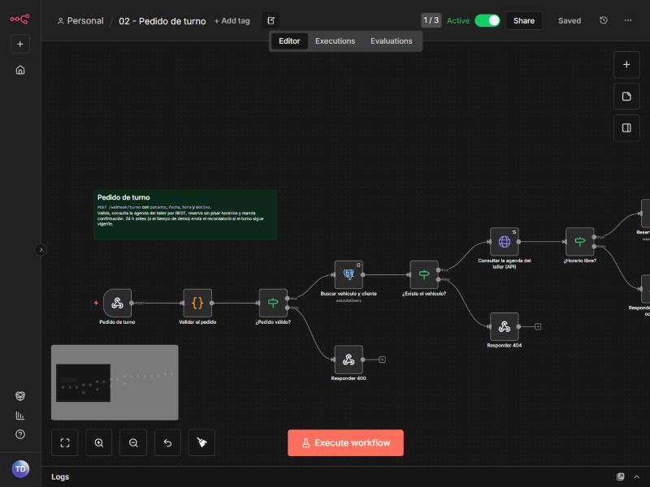
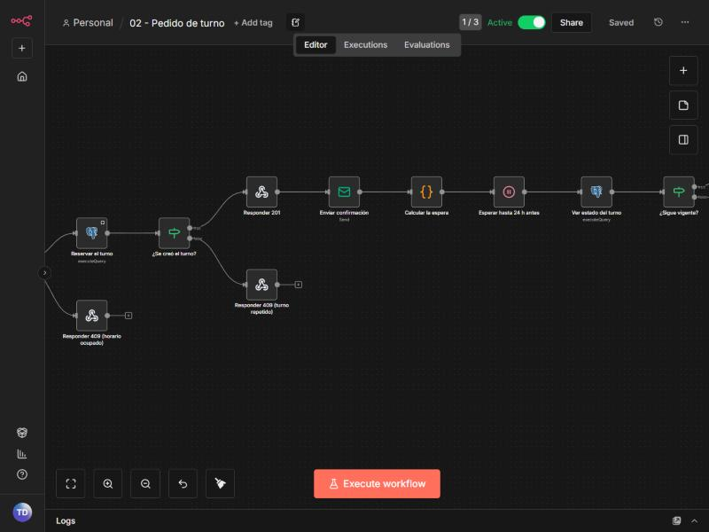
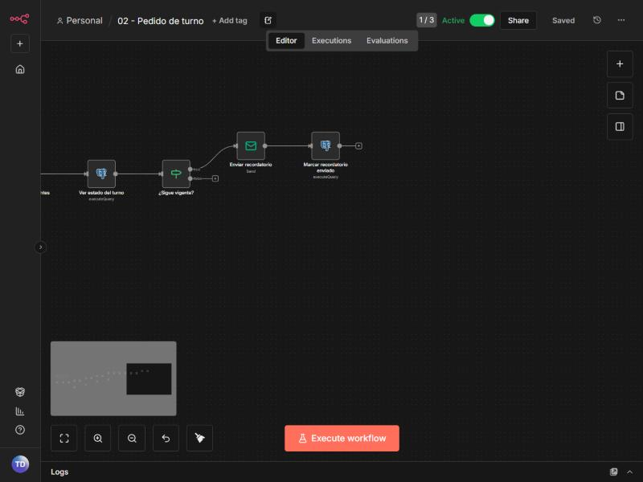

## 03 - Lista de precios de repuestos

El proveedor manda un archivo distinto cada día (separador y codificación variables, coma decimal, filas repetidas o inválidas). El flujo lo carga así:

1. Descarga el archivo desde la API del proveedor, con reintentos.
2. Lo manda a `POST /etl/precios`, donde Python lo limpia (decodifica, normaliza SKU, interpreta los números, descarta duplicados y precios inválidos).
3. En una sola sentencia SQL guarda cada línea cruda en `stg.precios_raw`, las rechazadas con su motivo en `stg.etl_rechazos`, y hace el merge a `ops.precios_repuestos`. Solo agrega una fila a `ops.precios_historial` cuando el precio cambió.
4. Busca variaciones de 8 % o más (`ops.v_variacion_precios`) y le manda un resumen a compras, **una sola vez por día**.

Correrlo dos veces el mismo día no cambia nada: el merge es idempotente y el aviso lleva clave por fecha.

```bash
docker compose exec postgres psql -U flota -d flota \
  -c "SELECT linea, motivo, contenido FROM stg.etl_rechazos ORDER BY id DESC LIMIT 10"
```

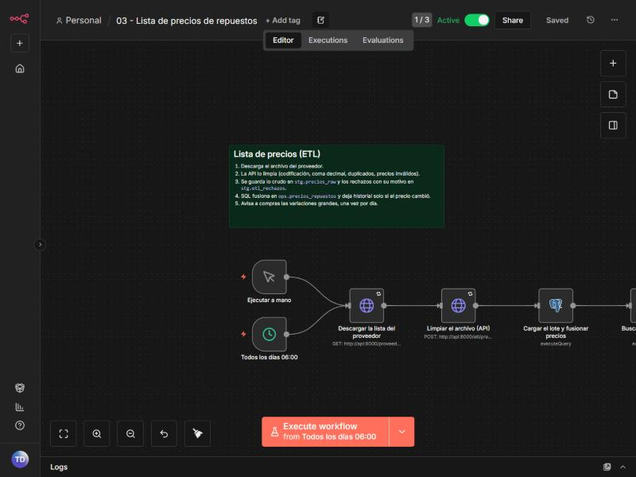
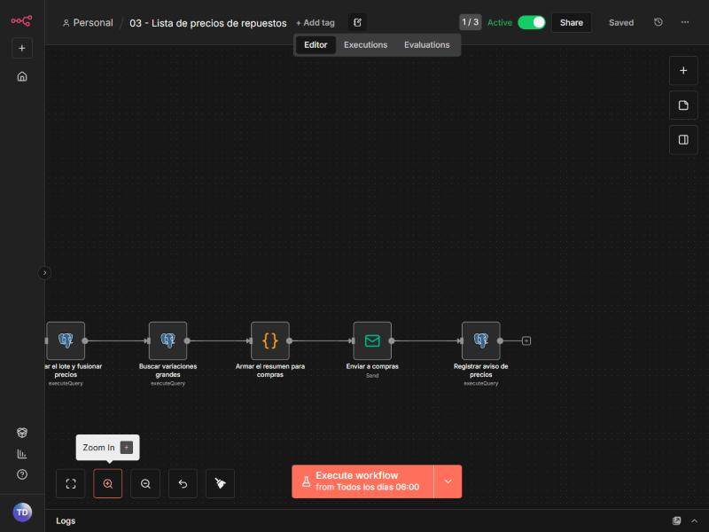

## 04 - Seguimiento preventivo

Cada lunes consulta a [VoltCare](https://github.com/MaxDCoc/VoltCare-Analytics) (`POST /analyze`) los indicadores de mantenimiento: MTTR global, de servicios preventivos y de correctivos de software atendidos por técnicos junior. Después aplica la regla que propone el análisis de VoltCare: un cliente con contrato activo que pasa de 45 días sin servicio preventivo recibe un **ticket de contacto**.

- Un solo ticket abierto por cliente y motivo (índice único parcial): reejecutar el flujo no duplica tickets.
- Gerencia recibe un resumen con los indicadores y la lista de clientes en alerta, **una sola vez por semana** (clave `semanal|<año-semana>`).

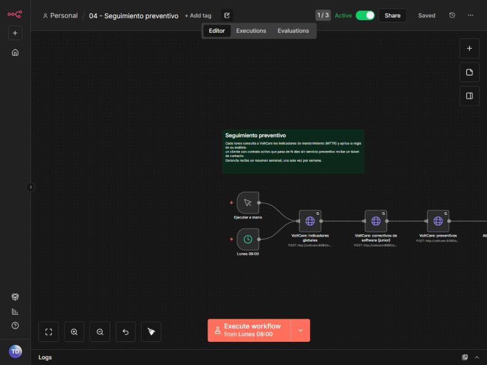
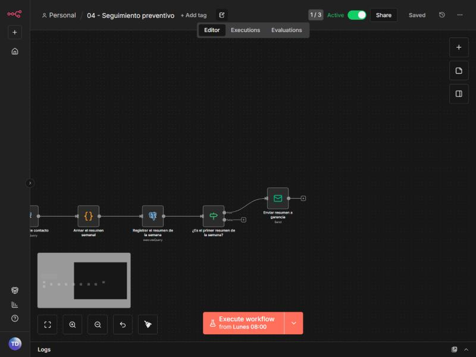

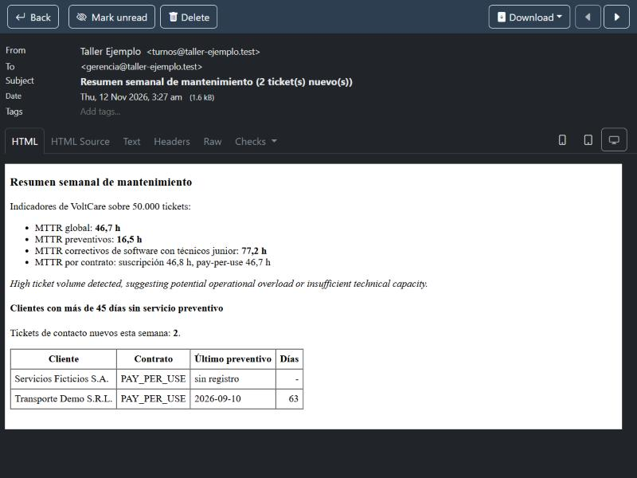

## 99 - Errores

Todos los flujos lo tienen asignado como flujo de error. Cuando uno falla, guarda el nodo y el mensaje en `ops.ejecuciones_error` y avisa por email a operaciones.

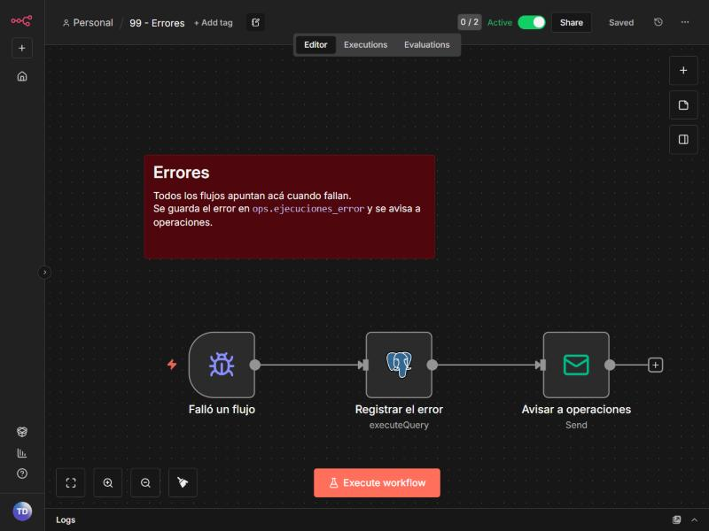

## Los emails

Salen por SMTP a Mailpit (`localhost:8025`) y no abandonan tu máquina.

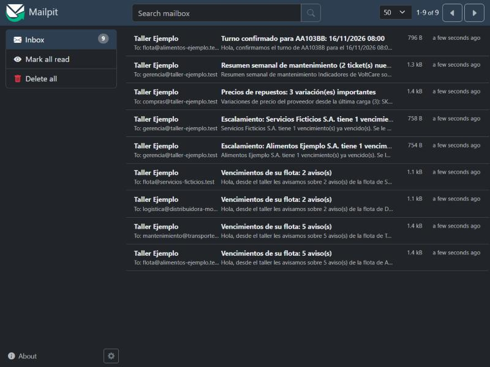
